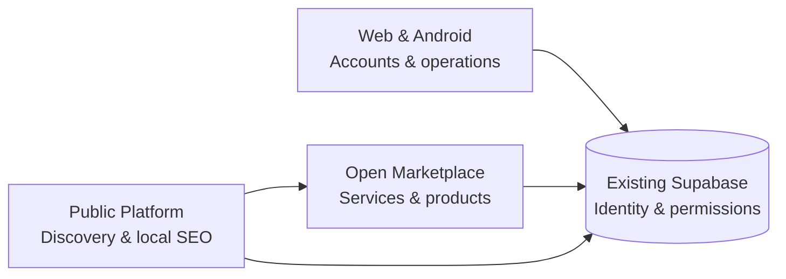

# بيت الريف | Biet Al Reef

### منظومة إماراتية للأعمال والبناء والخدمات المحلية
**UAE Digital Ecosystem for Construction, Business & Local Services**

**Discover businesses · Explore services · Connect with confidence**

[Android on Google Play](https://play.google.com/store/apps/details?id=ae.bietalreef.app) · [Public Platform Source](https://github.com/bietalreef/bietalreef-landing-new)

---

## ما هو بيت الريف؟ | About

**بيت الريف** منظومة رقمية تربط العملاء بالشركات والمؤسسات والاستشاريين والمقاولين والورش والحرفيين وموردي مواد البناء في دولة الإمارات. تجمع المنظومة **الاكتشاف المحلي** و**السوق المفتوح** و**مساحة إدارة الأعمال** ضمن منتجات مترابطة، مع الحفاظ على استقلالية الصلاحيات والموافقة على النشر في كل قناة.

**Biet Al Reef** helps people discover relevant businesses and services across the UAE through a public discovery platform, an open marketplace and an operational web/Android application. Each product has a distinct role and publication boundary.

### 🏗️ القطاعات | Who we serve

| القطاع / Sector | أمثلة / Examples |
| :--- | :--- |
| **الشركات والمؤسسات** · Companies & Establishments | Commercial activities and business profiles |
| **الاستشاريون** · Consultants | Engineering, architectural and design consultancies |
| **المقاولون** · Contractors | Construction, renovation and finishing |
| **الورش والحرفيون** · Workshops & Craftspeople | Trades, manufacturing and maintenance |
| **مواد البناء والموردون** · Building Materials & Suppliers | Materials, stores and supplier catalogs |

## 🧭 منتجاتنا | Product ecosystem

| المنتج | الاستخدام | الرابط |
| :--- | :--- | :--- |
| **Biet Al Reef Platform** | صفحات الأعمال والخدمات والاكتشاف حسب الإمارة والمدينة والتخصص | [bietalreef.ae](https://bietalreef.ae) |
| **Biet Al Reef Marketplace** | سوق مفتوح للخدمات والمنتجات والعروض العامة | [app.bietalreef.ae](https://app.bietalreef.ae) |
| **Biet Al Reef Web & Android** | الحسابات والمشاريع والطلبات وإدارة الأعمال حسب الصلاحيات | [Web](https://providers.bietalreef.ae) · [Android](https://play.google.com/store/apps/details?id=ae.bietalreef.app) |

## ⚙️ مبادئنا التقنية | Engineering principles

- **One source of truth:** established Supabase authentication, row-level security and channel-specific publication rules.
- **Independent delivery:** the Next.js public platform, React marketplace and Flutter Web/Android maintain separate codebases and release lifecycles.
- **Discoverability with integrity:** Arabic/English local-service content, genuine provider coverage and accessible public journeys; the Al Ain cleaning pilot is one operational focus.
- **Safety & privacy:** least privilege, sensitive-data boundaries and reviewed production changes. Security claims must be verified rather than assumed.
- **Cost discipline:** controlled builds, monitored infrastructure usage and measured changes rather than unnecessary deployments.

> **Deployment status:** The main public platform currently runs on Vercel. A separate Cloudflare Workers staging migration is planned; it is not yet the live platform. Existing marketplace and Web App deployments are independent.

## 🤝 التعاون والتوسع | Collaboration & future integrations

نصمم المنظومة بحيث يمكن إضافة مطورين أو وكلاء ذكاء اصطناعي أو تكاملات مستقبلية **من دون منحهم وصولًا تلقائيًا لبيانات العملاء أو الإنتاج**.

**Proposed contribution path:** idea or issue → scope review → separate branch/PR → automated checks → security review → owner approval → controlled release.

Each future module should have a clear owner, documented interfaces, least-privilege credentials, compatibility tests and rollback guidance. Contributions and integrations are evaluated case by case; this is **not** a blanket invitation to deploy code to production.

For collaboration inquiries, use the project's official public channels. **Never share API keys, passwords, personal records or security reports in public GitHub issues.**

## 🔗 Explore Biet Al Reef

[**Platform**](https://bietalreef.ae) · [**Marketplace**](https://app.bietalreef.ae) · [**Web App**](https://providers.bietalreef.ae) · [**Android**](https://play.google.com/store/apps/details?id=ae.bietalreef.app)

---

**بيت الريف · Biet Al Reef**  
*UAE local-business discovery, built with accountable engineering.*

Technical presence coordinated with Weyaak · Weyaak supports review and documentation; operational approval remains with project owners.

